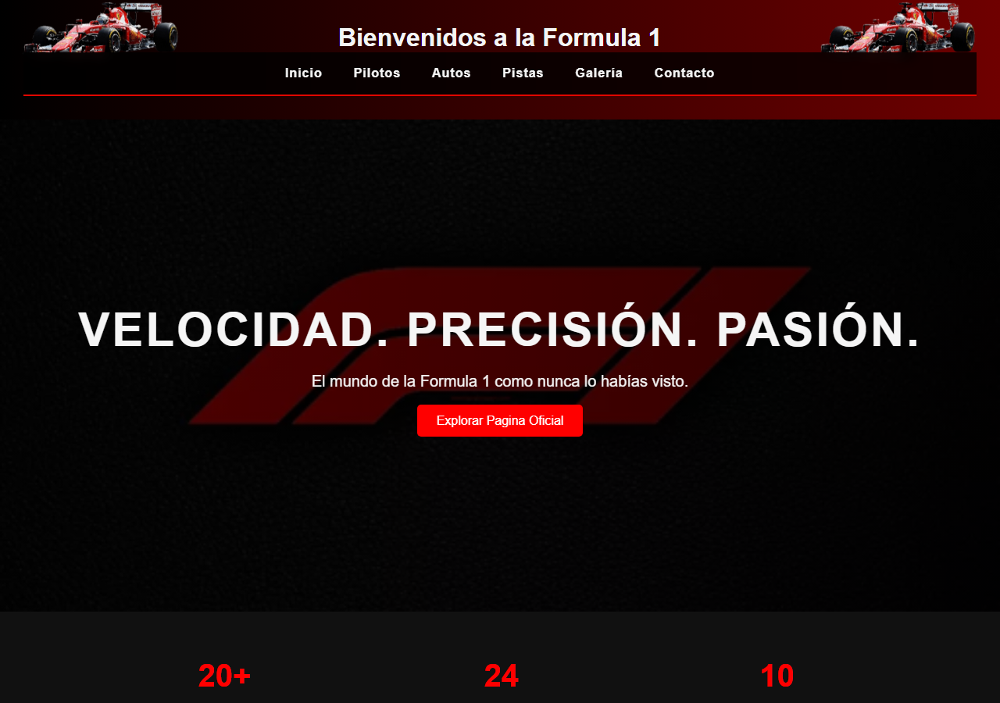

# Formula 1 Website

Sitio web multipágina para aficionados a la Fórmula 1: pilotos, autos, pistas, galería multimedia y un formulario de opinión.


**Demo:** https://toto05-a.github.io/formula1-website/



## Contenido

- **Inicio:** portada con estadísticas (pilotos, Grandes Premios, equipos), galería de equipos y video.
- **Pilotos:** Lewis Hamilton, Max Verstappen y Charles Leclerc.
- **Autos:** Red Bull Racing y Ferrari.
- **Pistas:** Mónaco y Silverstone.
- **Contacto:** formulario con campos de texto, correo, opciones de radio, lista de sugerencias (`datalist`) y casillas de verificación.

## Stack

HTML5 semántico · CSS3 (una hoja por página, diseño en rojo y negro) · Git y GitHub. Sin JavaScript ni dependencias.

## Estructura

```
├── index.html              # Redirige al sitio (para GitHub Pages)
├── Formula1_Website/       # Inicio, estilos, imágenes y favicon
│   ├── index.html
│   ├── styles.css
│   └── css/                # Estilos por página
├── pages/                  # pilotos, autos, pistas y formulario
└── video/                  # Video de la galería
```

## Cómo abrirlo

Abre `Formula1_Website/index.html` en el navegador, o sirve la carpeta:

```bash
python -m http.server 8000
# abre http://localhost:8000
```

## Notas

Proyecto de práctica realizado durante la formación en Campuslands. Las imágenes y el video son de aficionados y de terceros, usados solo con fines educativos.

## Autor

**Antonio Cruz** (Toto) · [@TOTO05-a](https://github.com/TOTO05-a) · Ingeniería de Sistemas, Guatemala.
